<p align="center">
  
</p>

```ts
const mostafa = {
  role:       "Backend Software Engineer",
  experience: "4+ years · production APIs, relational data models, third-party integrations",
  location:   "Damietta, Egypt",
  core:       ["NestJS", "TypeScript", "Ruby on Rails", "PostgreSQL"],
  also:       ["Redis", "BullMQ / Sidekiq", "Docker", "React", "Vue"],
  products:   4,            // live, with real customers
  lookingFor: "mid-level backend role on integration-heavy systems",
  contact:    "mostafasobh33@gmail.com",
  linkedin:   "https://www.linkedin.com/in/mostafa-sobh-3ba6531b2/",
  portfolio:  "https://mostafasobh.github.io",
};
```

### `$ cat ~/experience.log`

<table>
<tr>
<td valign="top" nowrap><code>2026 → now</code></td>
<td valign="top"><b>Elesely Group</b> · Full Stack Engineer (NestJS / React) · <sub>company code, private</sub><br>
Multi-warehouse e-commerce platform with Odoo ERP sync. Wrote the product spec (~14 epics, state machines, error catalog) and the full PostgreSQL data model. Built phone-OTP auth with rotating refresh sessions, Postgres full-text search (generated <code>tsvector</code> + GIN, <code>ts_rank</code>), a three-step multi-warehouse checkout with pricelist tiers and nearest-first stock split, BullMQ workers (push, maintenance), an Odoo JSON-RPC client with retry + circuit breaker, and the Docker Compose stack (Caddy, PostGIS, Redis, API, worker). Bilingual EN/AR React admin with RBAC.</td>
</tr>
<tr>
<td valign="top" nowrap><code>2025 → 2026</code></td>
<td valign="top"><b>LAZCare</b> · Software Engineer · <a href="https://lazcare.com">lazcare.com</a><br>
REST APIs and landing page for the NFC/QR emergency-bracelet app; supervised the Flutter app end to end. Built the DeepFace face-search service that runs beside the Rails app, with privacy rules: a face match reveals relatives' contacts only, full medical data needs a bracelet scan. Domains, SSL, Docker Compose deploys.</td>
</tr>
<tr>
<td valign="top" nowrap><code>2025 → now</code></td>
<td valign="top"><b>PageTribe</b> · personal project · <sub>currently offline</sub><br>
AI browser extension with a Rails backend: inline explanations and summaries on any page, public pages discovered by normalized URL, a GitHub-style fork model for edits, likes and comments. OpenAI and Gemini with bring-your-own keys, per-user token tracking and hard limits.</td>
</tr>
<tr>
<td valign="top" nowrap><code>2022 → 2025</code></td>
<td valign="top"><b>Maqsam</b> (Amman) · Software Engineer, cloud telephony · <sub>Rails + Vue</sub><br>
15+ client reporting pipelines in SQL and Ruby, delivered by Sidekiq jobs, tuned by indexing and killing N+1s. Production-to-analytics DB sync in batches with schema-change automation (Prestd). Owned the Unifonic SMS integration; integrated HubSpot CRM and Zoho Desk. Near-real-time billing dashboard. Central role migrating the portal to Vue Composition API + Pinia + Vite + TypeScript.</td>
</tr>
<tr>
<td valign="top" nowrap><code>2021 → 2022</code></td>
<td valign="top"><b>Maqsam</b> · Software Engineer Intern<br>Internal tools on Rails; an adaptive candidate-assessment tool with dynamic difficulty.</td>
</tr>
</table>

### `$ ls ~/stack`

<table>
<tr>
<td align="center"><sub><b>backend</b></sub><br></td>
<td align="center"><sub><b>data</b></sub><br></td>
</tr>
<tr>
<td align="center"><sub><b>frontend</b></sub><br></td>
<td align="center"><sub><b>ops &amp; tooling</b></sub><br></td>
</tr>
</table>

<sub>Also: TypeORM · Passport JWT · BullMQ · Sidekiq · Caddy · PostGIS · Odoo JSON-RPC · HubSpot · Zoho Desk · FCM · RSpec · Rollbar · StatsD</sub>

### `$ ls ~/products --live`

<table>
<tr>
<td width="220"><a href="https://lazcare.com"></a></td>
<td><b>laz/</b> &nbsp; <a href="https://lazcare.com">lazcare.com</a><br>NFC/QR medical ID bracelet. Any phone scans it, sees emergency info, and the family gets an alert with the location. Face search runs on my open-source <a href="https://github.com/mostafasobh/facial-recognition-service">facial-recognition-service</a>.<br><code>rails</code> <code>postgres</code> <code>python/deepface</code> <code>flutter</code></td>
</tr>
<tr>
<td width="220"><a href="https://sjlapp.com"></a></td>
<td><b>daleel/</b> &nbsp; <a href="https://sjlapp.com">sjlapp.com</a><br>Diagnostic assessment for Egyptian secondary students. Quizzes after every lesson, auto-grading including essays, per-concept mastery maps for teachers.<br><code>nestjs</code> <code>react-router-v7</code> <code>postgres</code></td>
</tr>
<tr>
<td width="220"><a href="https://elwesameldhby.online"></a></td>
<td><b>elwesam/</b> &nbsp; <a href="https://elwesameldhby.online">elwesameldhby.online</a><br>Online accounting for gold traders. Cash and gold ledgers, immutable audit trail, role-based access, PWA for the owner's phone.<br><code>nestjs</code> <code>postgres</code> <code>pwa</code></td>
</tr>
<tr>
<td width="220"><a href="https://lazcare.com/game"></a></td>
<td><b>laz-game/</b> &nbsp; <a href="https://lazcare.com/game">lazcare.com/game</a><br>A 60-second browser mission: find a lost child in a crowded street, identify them by bracelet or face search, call the family.<br><code>html5-canvas</code> <code>vanilla-js</code> <code>single-file</code></td>
</tr>
</table>

### `$ ls ~/open-source`

- [facial-recognition-service](https://github.com/mostafasobh/facial-recognition-service) — Python HTTP service returning ArcFace embeddings (DeepFace). Powers LAZ face search.
- [Twitter-Clone-API](https://github.com/mostafasobh/Twitter-Clone-API) — NestJS + GraphQL + TypeORM + PostgreSQL, JWT auth, DTO validation, Jest + supertest.
- [Node-Chat-App](https://github.com/mostafasobh/Node-Chat-App) — Express + Socket.IO real-time chat with a Mocha/Chai suite.
- [search-app](https://github.com/mostafasobh/search-app) — Rails app that logs what users type to surface trending searches.

### `$ git stats`

<p align="center">
  
</p>
<p align="center">
  
  
</p>

<p align="center">
  <a href="mailto:mostafasobh33@gmail.com"></a>
  <a href="https://www.linkedin.com/in/mostafa-sobh-3ba6531b2/"></a>
  <a href="https://mostafasobh.github.io"></a>
</p>
